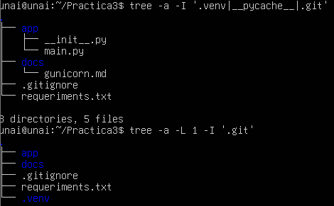
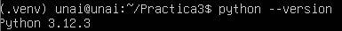
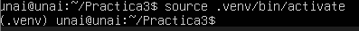
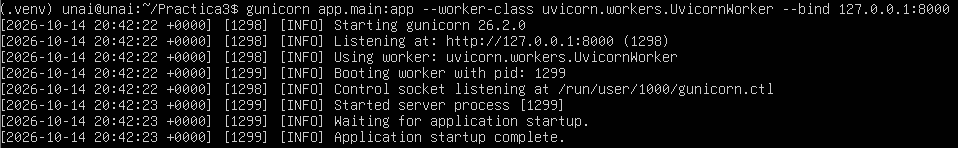
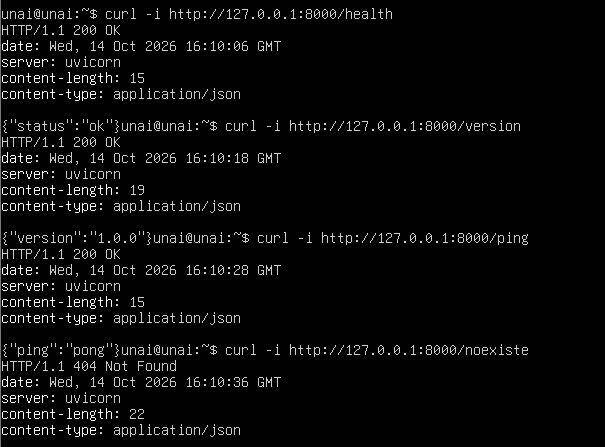
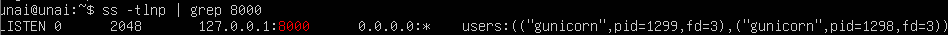

# Práctica 1.3 — Instalación básica de Gunicorn

**Objetivo:** instalar y verificar el servidor de aplicaciones Gunicorn con el backend de TaskFlow (FastAPI).

> La documentación detallada también está en [`docs/gunicorn.md`](docs/gunicorn.md).

## Entorno de trabajo

| Elemento | Valor |
|---|---|
| Sistema operativo | Ubuntu Server 24.04 LTS |
| Python | 3.13 (entorno virtual `.venv`) |
| Servidor de aplicaciones | Gunicorn 26.2.0 |
| Worker | `uvicorn.workers.UvicornWorker` |
| Framework | FastAPI |
| Dirección de escucha | `127.0.0.1:8000` |

La práctica se ha realizado en un servidor **Ubuntu Server 24.04 LTS**, porque Gunicorn solo funciona en sistemas Unix (Linux/macOS): Las capturas se han hecho sobre la consola del servidor y el código se ha subido a este repositorio de GitHub.

## Estructura del proyecto

```
Practica1.3/
├── app/
│   ├── __init__.py
│   └── main.py
├── docs/
│   └── gunicorn.md
├── evidencias/
│   ├── Curl4endpoint.png
│   ├── Entornovirtual_activo.png
│   ├── Estructura.png
│   ├── Gunicorn_funcionando.png
│   ├── puerto8000_escuchando.png
│   └── Version_python_.png
├── .gitignore
├── README.md
└── requirements.txt
```

El entorno virtual `.venv` y la caché `__pycache__` están excluidos del repositorio mediante `.gitignore`.



## 1. Pasos ejecutados

### 1.1 Python 3.13

Ubuntu Server 24.04 incluye Python 3.12 por defecto, pero la práctica exige 3.13 o superior. Se instaló desde el repositorio `deadsnakes`:

```bash
sudo apt update
sudo apt install -y software-properties-common
sudo add-apt-repository ppa:deadsnakes/ppa
sudo apt update
sudo apt install -y python3.13 python3.13-venv
python3.13 --version
```



### 1.2 Entorno virtual

```bash
mkdir -p ~/Practica3 && cd ~/Practica3
python3.13 -m venv .venv
source .venv/bin/activate
python --version
```

El prompt muestra `(.venv)` cuando el entorno está activo.



### 1.3 Dependencias

`requirements.txt`:

```
fastapi
uvicorn
gunicorn
```

```bash
pip install -r requirements.txt
gunicorn --version
```

### 1.4 Aplicación

Se añadió el fichero `app/main.py` de la práctica 1.1 (módulo de Desarrollo de aplicaciones usando frameworks), con los endpoints `/health`, `/version` y `/ping`:

```python
from fastapi import FastAPI

app = FastAPI()

@app.get("/health")
def health():
    return {"status": "ok"}

@app.get("/version")
def version():
    return {"version": "1.0.0"}

@app.get("/ping")
def ping():
    return {"ping": "pong"}
```

### 1.5 Arranque de Gunicorn

```bash
gunicorn app.main:app --worker-class uvicorn.workers.UvicornWorker --bind 127.0.0.1:8000
```

Salida esperada: `Listening at: http://127.0.0.1:8000`, `Using worker: uvicorn.workers.UvicornWorker` y `Booting worker with pid: ...`, sin errores.



### 1.6 Verificación con curl

Desde una segunda terminal del servidor:

```bash
curl -i http://127.0.0.1:8000/health
curl -i http://127.0.0.1:8000/version
curl -i http://127.0.0.1:8000/ping
curl -i http://127.0.0.1:8000/noexiste
```

Los tres primeros endpoints responden `HTTP/1.1 200 OK` con JSON válido. El cuarto, una ruta que no existe, devuelve `404 Not Found` con el JSON de error de FastAPI, lo que demuestra que responde la aplicación y no una página por defecto de un servidor web.



## 2. Evidencias de funcionamiento

| Evidencia | Captura |
|---|---|
| Versión de Python 3.13 | `evidencias/Version_python_.png` |
| Entorno virtual activo | `evidencias/Entornovirtual_activo.png` |
| Estructura del proyecto | `evidencias/Estructura.png` |
| Gunicorn arrancado | `evidencias/Gunicorn_funcionando.png` |
| Endpoints con curl (`/health`, `/version`, `/ping` y el 404 de `/noexiste`) | `evidencias/Curl4endpoint.png` |
| Puerto 8000 en escucha | `evidencias/puerto8000_escuchando.png` |

Comprobación del puerto y del bind (`ss -tlnp | grep 8000`): el servidor escucha únicamente en `127.0.0.1:8000`, no en todas las interfaces.



Además, la ruta inexistente `/noexiste` devuelve el `404` en JSON de FastAPI (visible en la captura de los cuatro `curl`), lo que demuestra que responde la aplicación y no una página por defecto de un servidor web.

## 3. Explicación de la orden

```bash
gunicorn app.main:app --worker-class uvicorn.workers.UvicornWorker --bind 127.0.0.1:8000
```

| Parte | Significado |
|---|---|
| `gunicorn` | Servidor de aplicaciones que gestiona procesos worker. |
| `app.main:app` | Formato `módulo:variable`. `app.main` es el fichero `app/main.py` y `app` es la instancia `FastAPI()` definida dentro. |
| `--worker-class uvicorn.workers.UvicornWorker` | Tipo de worker que ejecuta la aplicación. |
| `--bind 127.0.0.1:8000` | Dirección IP y puerto de escucha. `127.0.0.1` solo acepta conexiones locales; `0.0.0.0` escucharía en todas las interfaces. |

### ¿Por qué `UvicornWorker` es obligatorio?

Gunicorn es un servidor **WSGI** (interfaz síncrona), mientras que FastAPI es una aplicación **ASGI** (asíncrona). Gunicorn no entiende ASGI por sí mismo. `UvicornWorker` actúa de puente: cada worker de Gunicorn ejecuta Uvicorn internamente, que sí implementa ASGI. Sin él, la aplicación no arrancaría o no funcionaría correctamente.

### Servidor web vs servidor de aplicaciones

- **Servidor web (Apache, Nginx):** sirve ficheros estáticos, gestiona HTTP/HTTPS y reparte peticiones. No ejecuta por sí mismo el código Python de la aplicación.
- **Servidor de aplicaciones (Gunicorn):** ejecuta la aplicación Python y la conecta con HTTP mediante un estándar (WSGI/ASGI). Gestiona varios procesos **worker** que atienden peticiones en paralelo.

En producción se combinan: `cliente → Nginx/Apache → Gunicorn → FastAPI`.

### Bind: `127.0.0.1`, `localhost` y `0.0.0.0`

| Valor | Significado | Accesibilidad |
|---|---|---|
| `127.0.0.1` | Dirección de loopback (la propia máquina). | Solo desde el propio servidor. |
| `localhost` | Nombre que normalmente resuelve a `127.0.0.1` (y a veces a `::1` en IPv6). | Solo desde el propio servidor. |
| `0.0.0.0` | Todas las interfaces de red IPv4. | Accesible desde cualquier equipo de la red. |

### ¿Por qué Gunicorn escucha solo en `127.0.0.1`?

Gunicorn no está pensado para exponerse directamente a Internet (no gestiona bien clientes lentos, TLS ni ataques). Se deja escuchando solo en local y es el proxy inverso (Nginx/Apache) el único que lo alcanza. Así se reduce la superficie de ataque. Por eso las pruebas con `curl` se hacen desde el propio servidor.

## 4. ¿Por qué Gunicorn y no solo Uvicorn?

Uvicorn por sí solo es un único proceso. Gunicorn añade la gestión de procesos propia de un entorno de producción:

- Lanza varios workers y aprovecha varios núcleos de CPU.
- Reinicia automáticamente los workers que fallan.
- Permite recargas y paradas ordenadas mediante señales.
- Es un estándar probado para desplegar detrás de un proxy inverso como Nginx.

Uvicorn aporta el rendimiento asíncrono y Gunicorn la robustez de la gestión de procesos; usarlos juntos combina ambas ventajas.

## Cómo parar, arrancar y depurar

**Arrancar** (en primer plano, desde la raíz del proyecto y con el entorno activo):

```bash
source .venv/bin/activate
gunicorn app.main:app --worker-class uvicorn.workers.UvicornWorker --bind 127.0.0.1:8000
```

**Parar:**

- En la terminal donde corre: `Ctrl+C` (parada ordenada).
- Desde otra terminal: localizar el proceso master con `ps aux | grep [g]unicorn` y ejecutar `kill -TERM <PID_master>` (o `pkill gunicorn`).

**Recargar sin cortar el servicio:** `kill -HUP <PID_master>`.

**Depurar errores comunes:**

| Error | Causa probable | Qué hacer |
|---|---|---|
| `Address already in use` | Ya hay algo escuchando en el puerto 8000. | `ss -tlnp \| grep 8000` y parar ese proceso. |
| `No module named 'app'` | Se lanzó desde otra carpeta o falta `app/__init__.py`. | `pwd`, `ls app` y ejecutar desde la raíz. |
| `No module named 'fastapi'` | El entorno virtual no está activo o faltan dependencias. | `source .venv/bin/activate` y `pip install -r requirements.txt`. |
| `Failed to parse '...' as an attribute name` | Mal formato `módulo:variable`. | Usar `app.main:app`. |
| `Worker failed to boot` | Error dentro de `main.py` (sintaxis, importación). | Leer el traceback justo antes del mensaje. |
| El worker no arranca o `uvicorn.workers` da aviso de obsoleto | Versión reciente de Uvicorn. | `pip install uvicorn-worker` y usar `uvicorn_worker.UvicornWorker`. |

Para más detalle se puede arrancar con `--log-level debug`.

## Problemas encontrados y soluciones

| Problema | Causa | Solución |
|---|---|---|
| `E: Permission denied` al ejecutar `apt install` | `apt` necesita privilegios de administrador. | Usar `sudo`. |
| `Failed to parse 'main:app' as an attribute name or function call` | Se escribió `app:main:app` en lugar de `app.main:app`. | Corregir la orden: el módulo se separa con punto y la variable con dos puntos. |
| `SyntaxError: invalid syntax` en `main.py`, línea 1 | La importación estaba escrita como `from fast api import FastAPI` (con espacio). | Corregirla a `from fastapi import FastAPI`. |
| `tree` no mostraba `.venv` | `tree` oculta por defecto los elementos que empiezan por punto, y se había excluido con `-I`. | Usar `tree -a -L 1 -I '.git'` para verlo. |
| Nombres de fichero con erratas (`requeriments.txt`) | Error al crear el fichero. | Renombrar a `requirements.txt`. |

## Cómo reproducir la práctica

```bash
git clone <URL_DEL_REPOSITORIO>
cd <NOMBRE_DEL_REPOSITORIO>
python3.13 -m venv .venv
source .venv/bin/activate
pip install -r requirements.txt
gunicorn app.main:app --worker-class uvicorn.workers.UvicornWorker --bind 127.0.0.1:8000
```

En otra terminal: `curl -i http://127.0.0.1:8000/health`.


## Nota sobre este repositorio

Este repositorio no es el proyecto oficial en ejecución, sino una **representación** de lo que se encuentra en el servidor **Ubuntu Server 24.04 LTS**, donde están instalados el entorno virtual (`.venv`) y Gunicorn, y donde todo funciona correctamente.

El entorno virtual no se incluye en el repositorio, porque está excluido mediante `.gitignore`. Las capturas de la carpeta `evidencias/` demuestran el funcionamiento real en el servidor: versión de Python, entorno virtual activo, Gunicorn arrancado, respuesta de los endpoints y puerto en escucha.